

<a href="https://github.com/behnia137/benibix-feedback/issues/new?template=feedback.yml"><picture><source media="(prefers-color-scheme: dark)" srcset="assets/hero-dark.svg"></picture></a>
  
<picture><source media="(prefers-color-scheme: dark)" srcset="assets/h-how-dark.svg"></picture>
<picture><source media="(prefers-color-scheme: dark)" srcset="assets/how-dark.svg">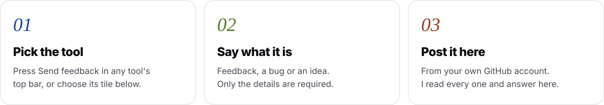</picture>
  
<picture><source media="(prefers-color-scheme: dark)" srcset="assets/h-tools-dark.svg"></picture>
<picture><source media="(prefers-color-scheme: dark)" srcset="assets/row-coding-agents-claude-code-dark.svg"></picture> 
<a href="https://github.com/behnia137/benibix-feedback/issues/new?template=feedback.yml&tool=Config%20Studio%20for%20Claude%20Code"><picture><source media="(prefers-color-scheme: dark)" srcset="assets/tile-config-studio-for-claude-code-dark.svg"></picture></a><a href="https://github.com/behnia137/benibix-feedback/issues/new?template=feedback.yml&tool=Statusline%20Studio"><picture><source media="(prefers-color-scheme: dark)" srcset="assets/tile-statusline-studio-dark.svg"></picture></a><a href="https://github.com/behnia137/benibix-feedback/issues/new?template=feedback.yml&tool=Usage%20Insights%20for%20Claude%20Code"><picture><source media="(prefers-color-scheme: dark)" srcset="assets/tile-usage-insights-for-claude-code-dark.svg"></picture></a>
  
<picture><source media="(prefers-color-scheme: dark)" srcset="assets/row-coding-agents-codex-dark.svg"></picture> 
<a href="https://github.com/behnia137/benibix-feedback/issues/new?template=feedback.yml&tool=Config%20Studio%20for%20Codex"><picture><source media="(prefers-color-scheme: dark)" srcset="assets/tile-config-studio-for-codex-dark.svg"></picture></a><a href="https://github.com/behnia137/benibix-feedback/issues/new?template=feedback.yml&tool=Usage%20Insights%20for%20Codex"><picture><source media="(prefers-color-scheme: dark)" srcset="assets/tile-usage-insights-for-codex-dark.svg"></picture></a>
  
<picture><source media="(prefers-color-scheme: dark)" srcset="assets/row-prompts-github-dark.svg"></picture> 
<a href="https://github.com/behnia137/benibix-feedback/issues/new?template=feedback.yml&tool=Character%20Prompt%20Builder"><picture><source media="(prefers-color-scheme: dark)" srcset="assets/tile-character-prompt-builder-dark.svg"></picture></a><a href="https://github.com/behnia137/benibix-feedback/issues/new?template=feedback.yml&tool=Prompt%20Gallery"><picture><source media="(prefers-color-scheme: dark)" srcset="assets/tile-prompt-gallery-dark.svg"></picture></a><a href="https://github.com/behnia137/benibix-feedback/issues/new?template=feedback.yml&tool=Profile%20README%20Studio"><picture><source media="(prefers-color-scheme: dark)" srcset="assets/tile-profile-readme-studio-dark.svg"></picture></a>
  
<picture><source media="(prefers-color-scheme: dark)" srcset="assets/row-data-dark.svg"></picture> 
<a href="https://github.com/behnia137/benibix-feedback/issues/new?template=feedback.yml&tool=Chart%20Compass"><picture><source media="(prefers-color-scheme: dark)" srcset="assets/tile-chart-compass-dark.svg"></picture></a><a href="https://github.com/behnia137/benibix-feedback/issues/new?template=feedback.yml&tool=KPI%20Atlas"><picture><source media="(prefers-color-scheme: dark)" srcset="assets/tile-kpi-atlas-dark.svg"></picture></a><a href="https://github.com/behnia137/benibix-feedback/issues/new?template=feedback.yml&tool=Report%20Design%20Studio"><picture><source media="(prefers-color-scheme: dark)" srcset="assets/tile-report-design-studio-dark.svg"></picture></a>
  
<picture><source media="(prefers-color-scheme: dark)" srcset="assets/row-design-dark.svg"></picture> 
<a href="https://github.com/behnia137/benibix-feedback/issues/new?template=feedback.yml&tool=Icon%20Studio"><picture><source media="(prefers-color-scheme: dark)" srcset="assets/tile-icon-studio-dark.svg"></picture></a><a href="https://github.com/behnia137/benibix-feedback/issues/new?template=feedback.yml&tool=Motion%20Studio"><picture><source media="(prefers-color-scheme: dark)" srcset="assets/tile-motion-studio-dark.svg"></picture></a>
  
<picture><source media="(prefers-color-scheme: dark)" srcset="assets/row-site-dark.svg"></picture> 
<a href="https://github.com/behnia137/benibix-feedback/issues/new?template=feedback.yml&tool=The%20site%20itself"><picture><source media="(prefers-color-scheme: dark)" srcset="assets/tile-site-dark.svg"></picture></a><a href="https://github.com/behnia137/benibix-feedback/issues/new?template=feedback.yml&tool=A%20new%20tool&type=%F0%9F%92%A1%20Idea%20(a%20feature%20or%20improvement)"><picture><source media="(prefers-color-scheme: dark)" srcset="assets/tile-new-dark.svg"></picture></a>
  

Issues here are public: anyone can read your message, your GitHub username and the page you sent it from, so leave out anything private. 
How this works with your data: <a href="https://tools.benibix.com/privacy/">privacy page</a>, section 2.6. The tools themselves: <a href="https://tools.benibix.com">tools.benibix.com</a>. 
These pictures are drawn by <code>scripts/gen.mjs</code> from the site's own data.

